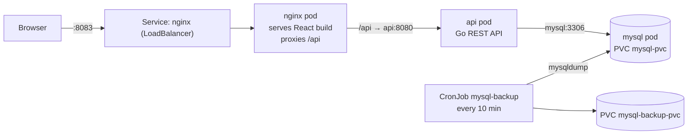
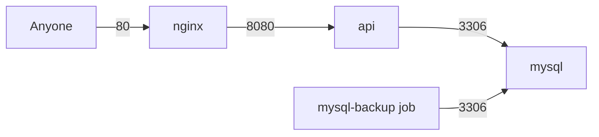

# k8s_experiments_02: a small full-stack app, from debug container to Kubernetes

A deliberately small example app, built to show **how the same application runs in two ways**:

1. **Debug mode:** Docker Compose, source folders mounted into containers, debug from VS Code.
2. **Kubernetes mode:** multi-arch images, manifests, network policies, persistent storage and scheduled backups.

The app itself is a simple CRUD system (users, customers, clients, orders). The UI text is in Norwegian.

> **⚠️ Kubernetes mode pushes images to a registry. The default is the author's Docker Hub account (`docker.io/magneka`), which you cannot push to.**
> Use your own account by setting `REGISTRY`, see [Use your own Docker Hub account](#use-your-own-docker-hub-account). Debug mode (Compose) needs no registry.

---

## How this was made

This project was built from a written specification rather than coded by hand:

1. **Overview:** I first described what I wanted in [overview.md](overview.md): the components, folder layout, debug setup, database, API, React app and Kubernetes variant, plus the ground rules (no compilation on the host, Norwegian UI text).
2. **Plan:** I then used the overview to create an implementation plan, [plan.md](plan.md). It turns the requirements into a shared contract (env variables, ports, tables, REST API) and a list of steps that could be worked on independently.
3. **Implementation:** The code, manifests and scripts were produced by following the plan step by step, and both documents were updated afterwards to match what was actually built.

If you want to understand *why* something looks the way it does, start in [overview.md](overview.md); for *how* it was broken down and built, see [plan.md](plan.md).

---

## 1. Architecture



| Layer | Tech | Folder |
|---|---|---|
| Database | MySQL 8.4 (utf8mb4) | [db/init/](db/init) |
| REST API | Go 1.23, standard-library `net/http`, bcrypt | [api/](api), code in [api/src/](api/src) |
| Frontend | React + TypeScript + Vite, Redux Toolkit, react-router | [web/](web) |
| Web server / reverse proxy | nginx | [nginx/](nginx) |
| Kubernetes manifests | plain YAML, numbered for apply order | [k8s/](k8s) |
| Start/stop scripts | `.sh` (macOS/Linux) and `.bat` (Windows) | [scripts/](scripts) |

**Design principle: nginx is the only entry point.** The browser only talks to nginx. nginx serves the static React build and forwards everything under `/api/` to the Go API. The API and the database are never exposed outside the cluster.

---

## 2. Repository layout

```
.env / .env.example     secrets for MySQL (.env is git-ignored)
db/init/                01_schema.sql, 02_seed.sql (run automatically on first start)
api/                    Dockerfile (prod), Dockerfile.debug (Delve), src/ = Go code
web/                    React app (Vite), Dockerfile.dev
nginx/                  nginx.conf + Dockerfile (builds web/, serves it)
k8s/                    00-namespace, 10-mysql, 20-api, 30-nginx, 40-networkpolicy, 50-mysql-backup
scripts/                debug-up/down, k8s-up/down, k8s-kill-all, db-backup-pull
docker-compose.debug.yml
.devcontainer/          one devcontainer.json per service (api, web)
design_system/          uc-design8.html, the reference the React components are built from
overview.md / plan.md   the original requirements and the implementation plan
```

---

## 3. The application

### Database
Four tables: `users`, `customers`, `clients`, `orders` (`orders` has foreign keys to customers and, optionally, clients).

- The SQL in `db/init/` is run by the official MySQL image **only when the data directory is empty** (first start).
- Both files start with `SET NAMES utf8mb4;` so Norwegian characters (æøå) are stored correctly.
- Passwords are stored as **bcrypt hashes**. Seed logins (dev only): `admin / Admin123!`, other users `User123!`.

### Go API
Four files, one concern each:

| File | Responsibility |
|---|---|
| `main.go` | config from environment, DB connect with retry, routes, CORS, server start |
| `models.go` | structs |
| `db.go` | all SQL (parameterized queries only) |
| `handlers.go` | JSON in/out and HTTP handlers |

Endpoints (all JSON, errors are `{"error": "..."}`):

```
GET  /api/health
GET | POST            /api/{users|customers|clients|orders}
GET | PUT | DELETE    /api/{users|customers|clients|orders}/{id}
```

Users accept a `password` on create/update; it is hashed and `password_hash` is never returned.

### React app
- Built **design-system first**: the CSS from `design_system/uc-design8.html` is copied unchanged, and the components in `web/src/components/` reproduce its HTML structure and class names.
- Menus: **Hjem** (dashboard), **Registrer** (forms), **Oversikt** (lists with edit/delete), **Designsystem** (one page per design-system section for side-by-side comparison).
- State: Redux Toolkit, one slice per table (`web/src/store/`), all HTTP calls in `web/src/api/client.ts`.

---

## 4. Configuration and secrets

Copy the example and change the passwords:

```bash
cp .env.example .env
```

| Variable | Meaning |
|---|---|
| `MYSQL_ROOT_PASSWORD` | MySQL root password (also used by the backup job) |
| `MYSQL_DATABASE` / `MYSQL_USER` / `MYSQL_PASSWORD` | application database and user |
| `DB_HOST` / `DB_PORT` | where the API finds MySQL (`mysql:3306`) |
| `API_PORT` | API listen port (8080) |

`.env` is git-ignored. In Kubernetes the same file becomes the Secret `app-secrets` (see below).

---

## 5. Run mode A: debug with Docker Compose

Prerequisite: Docker. **No Go, Node or npm is needed on the host.** Everything compiles inside containers.

```bash
scripts/debug-up.sh      # docker compose -f docker-compose.debug.yml up -d --build
scripts/debug-down.sh    # down -v --remove-orphans --rmi local (removes containers, volumes, local images)
```

(`.bat` versions exist for Windows.)

| Service | What it does | Host port |
|---|---|---|
| `mysql` | MySQL 8.4, seeded from `db/init`, healthcheck | **3307** (3306 is used by mini_jira) |
| `api` | Go + Delve + gopls, **interactive with no start command** | **8082** (the API listens on 8080 inside the container; host 8080 is used by eurostack_office) |
| `web` | Vite dev server, proxies `/api` to `http://api:8080` | 5173 |

How debugging works:

- `./api/src` and `./web` are **bind-mounted** into the containers, so edits on the host show up immediately (the Vite dev server uses polling to detect changes).
- **Go:** attach VS Code to the `api` container (the `.devcontainer/api` config installs the Go extension there). Run **Debug API** from inside the container: Delve starts the API, with breakpoints working. Tasks `api: build`, `api: vet` and `api: run` are available. The container has `SYS_PTRACE` and `seccomp:unconfined`, which Delve needs.
- **React:** open http://localhost:5173 and run the **Debug React (Chrome)** launch config from the host-side `.vscode/launch.json`. Source maps are enabled.
- Because `api` has no start command, nothing answers on <http://localhost:8082> until you start the API from VS Code.

**URLs in debug mode:**

| What | URL |
|---|---|
| Web app (Vite) | <http://localhost:5173> |
| API health check | <http://localhost:8082/api/health> |
| API through the Vite proxy | <http://localhost:5173/api/customers> |
| MySQL (e.g. from a DB client) | `localhost:3307` |

---

## 6. Run mode B: Kubernetes

For a managed cloud cluster, see [7. Deploy to the cloud](#7-deploy-to-the-cloud-ovhcloud-azure-aws).

### Prerequisites
- `kubectl` pointing at a cluster (the **current context** is used, or set `KUBE_CONTEXT`).
- The cluster needs a default **StorageClass** and, ideally, a **LoadBalancer** provider.
- `docker` with `buildx`, and `docker login` to a registry the cluster can pull from.
- A CNI that enforces NetworkPolicy (e.g. kindnet on Docker Desktop), otherwise the policies are silently ignored.

### Use your own Docker Hub account

`k8s-up` builds the images and **pushes them to a registry**, then the cluster pulls them from there. The default is `docker.io/magneka`. Nothing in the manifests needs editing: you only change the `REGISTRY` variable. The images end up as `<REGISTRY>/k8sexp-api:<TAG>` and `<REGISTRY>/k8sexp-nginx:<TAG>`.

**Step 1:** log in with your own account (an access token works as the password):

```bash
docker login            # enter YOUR Docker Hub username and password/token
```

**Step 2:** run the script with `REGISTRY` set to `docker.io/<your-dockerhub-username>`:

macOS / Linux:

```bash
REGISTRY=docker.io/yourname scripts/k8s-up.sh
```

Windows (cmd):

```bat
set REGISTRY=docker.io/yourname
scripts\k8s-up.bat
```

To avoid typing it every time, export it in your shell profile (`export REGISTRY=docker.io/yourname`), or change the default on the `REGISTRY=` line near the top of [k8s-up.sh](scripts/k8s-up.sh) and the `if "%REGISTRY%"==""` line in [k8s-up.bat](scripts/k8s-up.bat).

Notes:
- Other registries work the same way, e.g. `REGISTRY=ghcr.io/yourname` or `REGISTRY=myregistry.azurecr.io/team` (log in with `docker login <registry>` first).
- The repositories `k8sexp-api` and `k8sexp-nginx` are created in your account on the first push. The cluster must be able to pull them: keep them **public**, or add an `imagePullSecret` (not included in these manifests).
- Without `REGISTRY` the script tries to push to `magneka`, and fails with an "access denied" error.

### Deploy and remove

```bash
docker login
REGISTRY=docker.io/yourname scripts/k8s-up.sh   # build, push, deploy
scripts/k8s-down.sh                             # delete the namespace (including the database volume!)
```

Optional environment variables: `REGISTRY` (default `docker.io/magneka`, **change this**), `TAG` (default timestamp), `PLATFORMS` (default `linux/amd64,linux/arm64`), `KUBE_CONTEXT`, `LOCAL_PORT` (default 8083).

### What `k8s-up` does

1. **Builds and pushes two multi-arch images** (amd64 + arm64) with `docker buildx`: `k8sexp-api` and `k8sexp-nginx`.
   - API: multi-stage, cross-compiled static binary on `distroless/static:nonroot`.
   - nginx: a Node stage builds the React app, then only `dist/` is copied into `nginx:alpine`.
   - The build runs in a temporary BuildKit container (`buildx_buildkit_k8sexp-builder0`, required for multi-platform builds). It is removed again when the script finishes, so the next run starts with a cold build cache.
2. Applies `k8s/00-namespace.yaml` (namespace `app`).
3. Creates the **Secret** `app-secrets` from `.env` and the **ConfigMap** `db-init` from `db/init/`. These are generated by the script, not stored in git.
4. Applies all `k8s/[0-9]*.yaml` in order. The manifests use the placeholder images `k8sexp-api` and `k8sexp-nginx`; the script substitutes the real registry/tag on the fly, so the manifests stay generic.
5. Waits for the three Deployments to be rolled out.
6. Prints the app URL, `http://<LoadBalancer address>:8083`. On Docker Desktop this is <http://localhost:8083>. If the cluster has no LoadBalancer provider, it starts a background `kubectl port-forward` and prints `http://localhost:8083`. `k8s-down` stops it again.

**URLs in Kubernetes mode:**

| What | URL |
|---|---|
| Web app (Docker Desktop or port-forward) | <http://localhost:8083> |
| API health check (through nginx) | <http://localhost:8083/api/health> |
| Web app on a cloud cluster | `http://<EXTERNAL-IP>:8083` |

The Service uses port **8083** rather than 80 so it can run next to the other solutions in this repo: on Docker Desktop, port 80 belongs to the ingress-nginx controller used by eurostack_office. The API and MySQL are not reachable from your machine in this mode.

### The manifests

| File | Contents |
|---|---|
| `00-namespace.yaml` | namespace `app` |
| `10-mysql.yaml` | PVC `mysql-pvc` (2Gi), Deployment (1 replica, strategy `Recreate`), ClusterIP Service. `db-init` is mounted at `/docker-entrypoint-initdb.d` |
| `20-api.yaml` | Deployment with readiness/liveness probes on `/api/health`, runs as non-root (uid 65532), resource limits, ClusterIP Service |
| `30-nginx.yaml` | Deployment + **LoadBalancer** Service on port 8083 (to nginx port 80), the only externally reachable service |
| `40-networkpolicy.yaml` | firewall rules, see below |
| `50-mysql-backup.yaml` | scheduled backups, see below |

### Network policies (zero trust inside the namespace)

`default-deny-ingress` blocks all incoming pod traffic. Only these flows are then opened:



Services are `ClusterIP` (internal only), and the policies add a second layer: even another pod in the cluster cannot reach the API or MySQL directly.

### Backups

`50-mysql-backup.yaml` contains:

- a **separate PVC** `mysql-backup-pvc` (1Gi), so losing the database volume does not also lose the backups,
- a **CronJob** that runs every 10 minutes, runs `mysqldump --all-databases` (gzipped), writes to a temp name and renames it only on success (a failed dump never counts as a backup), and keeps only the **3 newest** files,
- an extra NetworkPolicy that lets the backup pod reach MySQL.

Fetch backups to your machine:

```bash
scripts/db-backup-pull.sh --list   # list backups in the cluster and locally
scripts/db-backup-pull.sh          # copy the newest one to ./backups/ (git-ignored)
```

The script starts a short-lived busybox pod that mounts the backup volume read-only, streams the file out, verifies it with `gzip -t`, and deletes the pod.

Manual restore (example):

```bash
gunzip -c backups/db-YYYYMMDD-HHMMSS.sql.gz | \
  kubectl -n app exec -i deploy/mysql -- sh -c 'mysql -uroot -p"$MYSQL_ROOT_PASSWORD"'
```

### Cleaning up

- `scripts/k8s-down.sh` removes the app namespace (and the data).
- `scripts/k8s-kill-all.sh` deletes all workloads in **every non-system namespace** of the current context, after asking for confirmation. Use with care.

---

## 7. Deploy to the cloud (OVHcloud, Azure, AWS)

The manifests are cluster-agnostic, so deploying to a cloud means the same three things everywhere:

1. **A managed Kubernetes cluster** and a working `kubectl` context.
2. **A registry the cluster can pull from** (set through `REGISTRY`).
3. **Run `scripts/k8s-up.sh`.** The `LoadBalancer` Service gets a public address from the cloud.

Common prerequisites: Docker with `buildx`, `kubectl`, and a filled-in `.env` (`cp .env.example .env`).

> **Before you expose this to the internet**
> - **Change every password in `.env`.** The seed data in `db/init/02_seed.sql` also contains the dev logins (`admin / Admin123!`). Remove or replace those users before a public deployment.
> - The app is served over plain **HTTP on port 8083**, with no TLS. Add an ingress or load balancer with a certificate before real use.
> - The cluster, disks and load balancer **cost money** while they exist. Clean up when done (see each section).

Things that apply to all three clouds:

- `k8s-up` waits about 60 seconds for the load balancer address. Cloud load balancers can take longer; if the script falls back to `localhost:8083` port-forward, get the real address later with:
  ```bash
  kubectl -n app get svc nginx      # wait until EXTERNAL-IP is filled in, then open http://<EXTERNAL-IP>:8083
  ```
- Check that the app is up: `kubectl -n app get pods` (all `Running`) and `curl http://<EXTERNAL-IP>:8083/api/health`.
- The images are multi-arch (amd64 + arm64), so they run on any node type.
- Remove the app with `scripts/k8s-down.sh`, **then** delete the cluster (otherwise the cloud load balancer and disks can be left behind and keep billing).

### 7.1 OVHcloud (Managed Kubernetes Service)

**Prerequisites:** an OVHcloud account with a **Public Cloud project**.

**Step 1: Create the cluster** (OVHcloud Control Panel)
1. *Public Cloud* → your project → *Managed Kubernetes Service* → **Create a cluster**.
2. Pick a region, a Kubernetes version, and a node pool (for example 2 × `B3-8`, or 1 node for a test).
3. Wait until the cluster status is *OK*.

**Step 2: Get the kubeconfig**
1. Open the cluster → *Kubeconfig file* → **Download**.
2. Point `kubectl` at it and verify:
   ```bash
   export KUBECONFIG=$HOME/Downloads/kubeconfig.yml
   kubectl get nodes
   ```

**Step 3: Registry.** The simplest options are:
- **Docker Hub**, public repositories: follow [Use your own Docker Hub account](#use-your-own-docker-hub-account) and use `REGISTRY=docker.io/yourname`.
- **OVHcloud Managed Private Registry** (Harbor): *Public Cloud → Managed Private Registry → Create*, then in Harbor create a project and set it to **public** (the manifests have no `imagePullSecret`). Log in with the Harbor user, then use the registry URL:
  ```bash
  docker login <registry-id>.<region>.container-registry.ovh.net
  export REGISTRY=<registry-id>.<region>.container-registry.ovh.net/<project>
  ```

**Step 4: Deploy**
```bash
REGISTRY=docker.io/yourname scripts/k8s-up.sh      # or the Harbor REGISTRY from step 3
kubectl -n app get svc nginx                      # EXTERNAL-IP is the OVHcloud load balancer
```

Notes: OVHcloud provides a default StorageClass (Cinder block storage), so the PVCs work without changes. The `LoadBalancer` Service creates an OVHcloud Load Balancer automatically; this takes a few minutes. The default network plugin enforces NetworkPolicy.

**Clean up:** `scripts/k8s-down.sh`, then delete the cluster in the Control Panel (*Managed Kubernetes Service → ⋯ → Delete*).

### 7.2 Azure (AKS + Azure Container Registry)

**Prerequisites:** the [Azure CLI](https://learn.microsoft.com/cli/azure/install-azure-cli) and an Azure subscription.

**Step 1: Log in and set variables**
```bash
az login
RG=k8sexp-rg
LOCATION=westeurope
ACR=k8sexpacr$RANDOM          # must be globally unique, lowercase letters and digits only
AKS=k8sexp-aks
az group create --name $RG --location $LOCATION
```

**Step 2: Create the registry and the cluster.** `--network-policy` must be set **at creation** for the NetworkPolicies to be enforced, and `--attach-acr` lets the cluster pull from your registry without an `imagePullSecret`.
```bash
az acr create --resource-group $RG --name $ACR --sku Basic
az aks create --resource-group $RG --name $AKS \
  --node-count 2 --generate-ssh-keys \
  --network-plugin azure --network-policy azure \
  --attach-acr $ACR
```

**Step 3: Connect `kubectl` and Docker**
```bash
az aks get-credentials --resource-group $RG --name $AKS
kubectl get nodes
az acr login --name $ACR
```

**Step 4: Deploy**
```bash
REGISTRY=$ACR.azurecr.io scripts/k8s-up.sh
kubectl -n app get svc nginx                      # EXTERNAL-IP is the Azure public IP
```

Notes: AKS has a default StorageClass (`managed-csi`, Azure Disk), so the PVCs work without changes. The `LoadBalancer` Service creates an Azure Load Balancer with a public IP automatically.

**Clean up:** `scripts/k8s-down.sh`, then delete everything in one go:
```bash
az group delete --name $RG --yes --no-wait
```

### 7.3 AWS (EKS + Elastic Container Registry)

**Prerequisites:** the [AWS CLI](https://docs.aws.amazon.com/cli/latest/userguide/getting-started-install.html) (configured with `aws configure` or SSO), [`eksctl`](https://eksctl.io), and an AWS account.

**Step 1: Set variables**
```bash
export AWS_REGION=eu-north-1
CLUSTER=k8sexp
ACCOUNT=$(aws sts get-caller-identity --query Account --output text)
```

**Step 2: Create the ECR repositories.** The names must match the image names exactly:
```bash
aws ecr create-repository --repository-name k8sexp-api   --region $AWS_REGION
aws ecr create-repository --repository-name k8sexp-nginx --region $AWS_REGION
aws ecr get-login-password --region $AWS_REGION | \
  docker login --username AWS --password-stdin $ACCOUNT.dkr.ecr.$AWS_REGION.amazonaws.com
```
(The ECR login token is valid for 12 hours.)

**Step 3: Create the cluster** (takes about 15 minutes). Worker nodes can pull from ECR in the same account without an `imagePullSecret`.
```bash
eksctl create cluster --name $CLUSTER --region $AWS_REGION \
  --nodes 2 --node-type t3.medium --with-oidc
aws eks update-kubeconfig --name $CLUSTER --region $AWS_REGION
kubectl get nodes
```

**Step 4: Enable persistent volumes.** EKS needs the **EBS CSI driver** for PVCs (MySQL and backups), plus a default StorageClass that uses it:
```bash
eksctl create iamserviceaccount --cluster $CLUSTER --region $AWS_REGION \
  --namespace kube-system --name ebs-csi-controller-sa \
  --attach-policy-arn arn:aws:iam::aws:policy/service-role/AmazonEBSCSIDriverPolicy \
  --role-only --role-name ${CLUSTER}-ebs-csi --approve
eksctl create addon --cluster $CLUSTER --region $AWS_REGION --name aws-ebs-csi-driver \
  --service-account-role-arn arn:aws:iam::$ACCOUNT:role/${CLUSTER}-ebs-csi --force

kubectl annotate storageclass gp2 storageclass.kubernetes.io/is-default-class- --overwrite
kubectl apply -f - <<'YAML'
apiVersion: storage.k8s.io/v1
kind: StorageClass
metadata:
  name: gp3
  annotations:
    storageclass.kubernetes.io/is-default-class: "true"
provisioner: ebs.csi.aws.com
volumeBindingMode: WaitForFirstConsumer
parameters:
  type: gp3
YAML
```

**Step 5: Enforce NetworkPolicies** (the VPC CNI ignores them until enabled):
```bash
aws eks update-addon --cluster-name $CLUSTER --region $AWS_REGION --addon-name vpc-cni \
  --configuration-values '{"enableNetworkPolicy":"true"}' --resolve-conflicts OVERWRITE
```

**Step 6: Deploy**
```bash
REGISTRY=$ACCOUNT.dkr.ecr.$AWS_REGION.amazonaws.com scripts/k8s-up.sh
kubectl -n app get svc nginx      # EXTERNAL-IP is a hostname (an AWS load balancer), can take 2-3 minutes
```

Notes: the `LoadBalancer` Service creates an AWS load balancer automatically; its DNS name is shown in `EXTERNAL-IP`.

**Clean up:** `scripts/k8s-down.sh` (wait until the load balancer is gone), then:
```bash
eksctl delete cluster --name $CLUSTER --region $AWS_REGION
aws ecr delete-repository --repository-name k8sexp-api   --region $AWS_REGION --force
aws ecr delete-repository --repository-name k8sexp-nginx --region $AWS_REGION --force
```

---

## 8. Things to point out in the knowledge-sharing session

- **Same app, two worlds:** compose for fast developer feedback, Kubernetes for the "real" deployment. The same `.env` and `db/init` feed both.
- **No host toolchain:** reproducible builds, since compilation always happens in containers.
- **Generic manifests:** no cluster-specific settings; the registry is injected by the script.
- **Secrets and config from files:** `kubectl create secret/configmap --dry-run=client -o yaml | kubectl apply -f -` is an idempotent pattern.
- **Layered security:** non-root containers, distroless image, ClusterIP, default-deny NetworkPolicy.
- **Stateful data:** PVC for the database, a separate PVC for backups, and the CronJob pattern with retention.
- **Probes:** readiness decides when traffic is sent, liveness decides when to restart.
- **Gotchas worth showing:**
  - the init SQL only runs against an empty volume,
  - `Recreate` strategy is needed for a single-writer RWO volume,
  - NetworkPolicies do nothing without an enforcing CNI,
  - the default deny also blocked the backup job until it got its own allow rule,
  - deleting the namespace can hang on a LoadBalancer finalizer if the cluster has no LB controller (handled in `k8s-down`).

## 9. Quick try-out

```bash
cp .env.example .env              # then edit the passwords

# A) developer mode
scripts/debug-up.sh               # http://localhost:5173 (start the API from VS Code in the api container)
scripts/debug-down.sh

# B) Kubernetes
docker login                      # your own Docker Hub account
REGISTRY=docker.io/yourname scripts/k8s-up.sh   # prints the URL (http://localhost:8083 on Docker Desktop)
scripts/db-backup-pull.sh --list
scripts/k8s-down.sh
```
